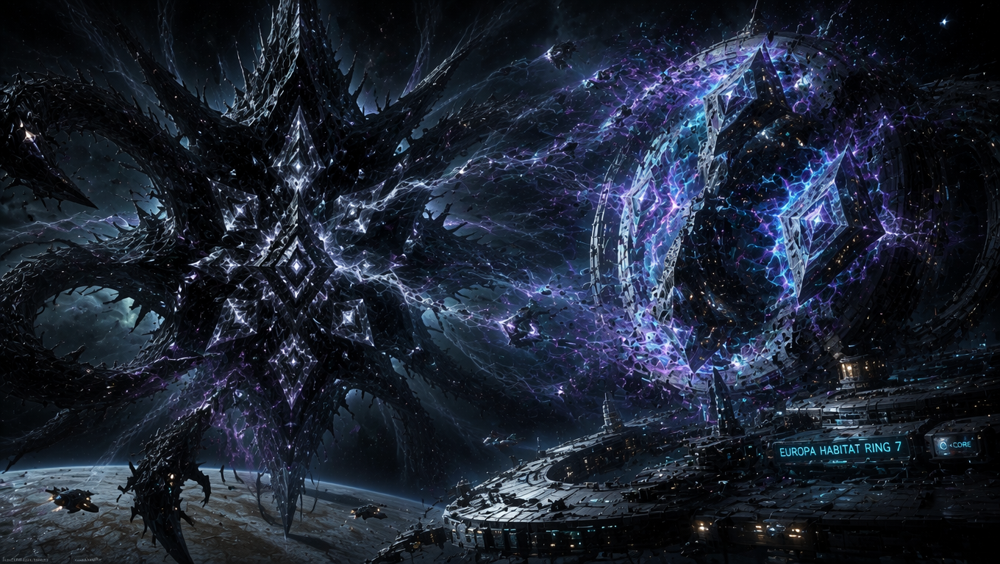
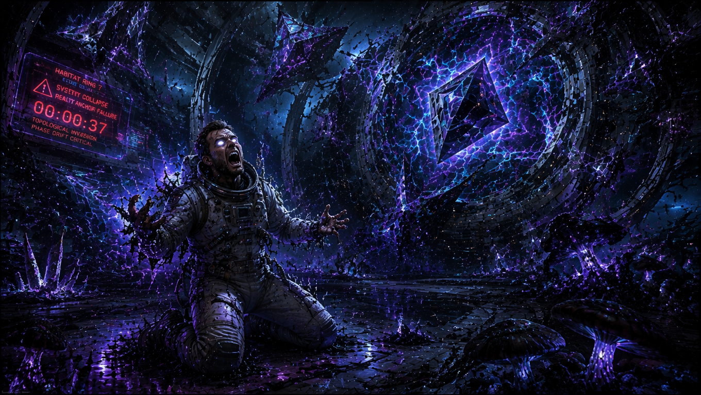
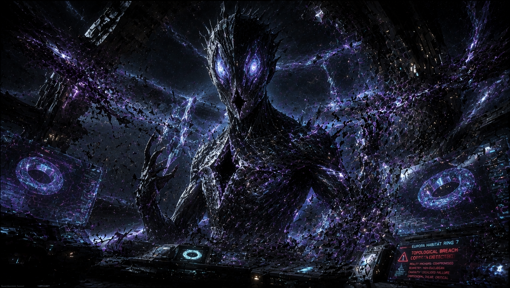
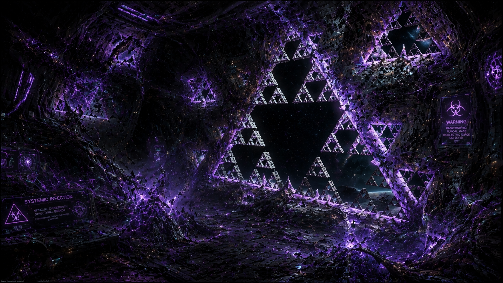
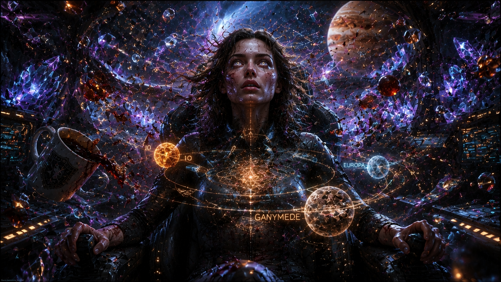
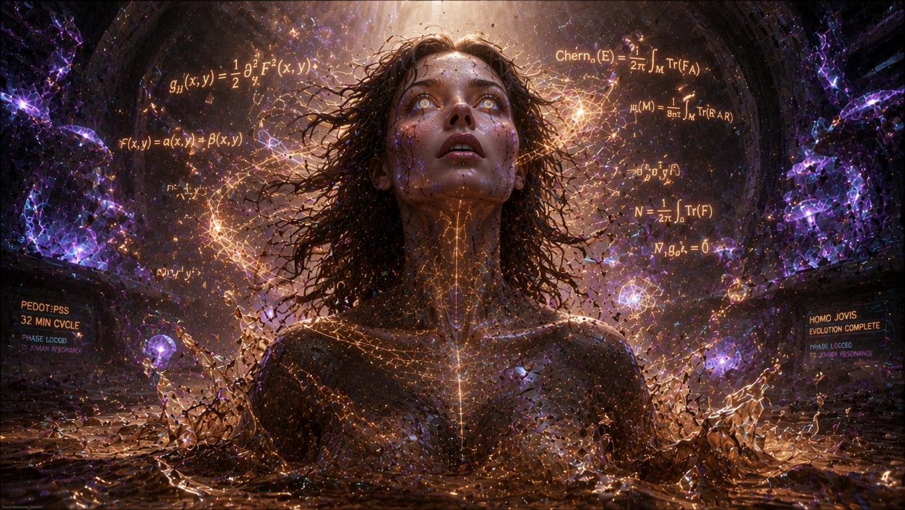
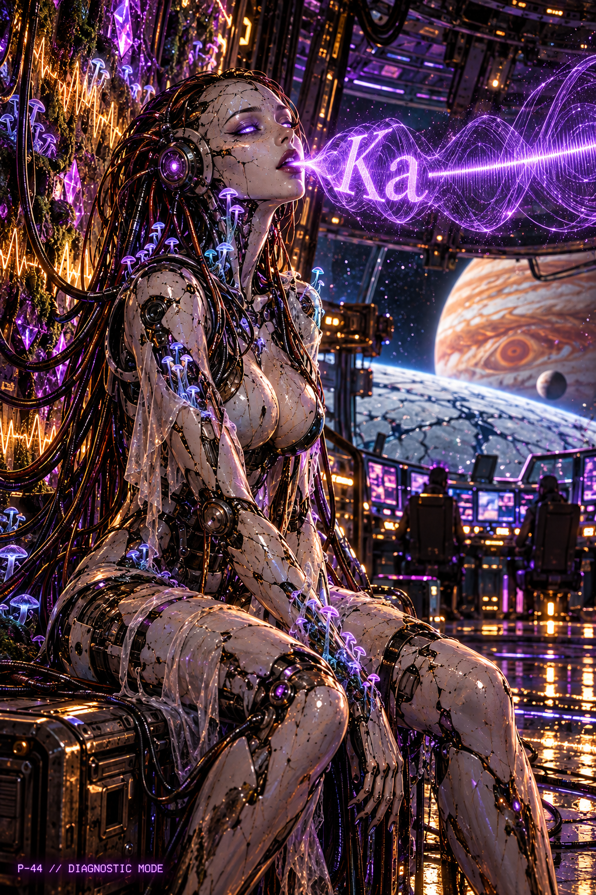

#ATAK NA TOPOLOGIĘ

Stacja „Nowy Eden-7”, orbita Europy, rok 2049.

Kapitan Lena Kowalska właśnie kończyła trzecią kawę z syntetycznego gówna, kiedy Q-Core Space zaczął wyć.

Nie był to zwykły alarm. Żadnego migania czerwonych świateł. Z głośników i grodzi wydobywał się niski, gardłowy, wibrujący dźwięk – jakby ktoś wbił stalowy widelec w czysty kryształ diamentu i kręcił nim powoli, rozrywając strukturę od środka.

– Co jest, kurwa… – mruknęła Lena, rzucając kubek i natychmiast uderzając w interfejs holoprojekcji.

Na głównym wyświetlaczu, zamiast dotychczasowego, spokojnego toroidalnego atraktora „Złotego Zapisu Edenu”, wirowała krwawa, poszarpana dziura. Wyglądało to tak, jakby jakaś zewnętrzna siła wzięła idealną geometrię zdrowej trajektorii fazowej i po prostu **przegryzła ją na pół**.

W tym samym momencie Living Walls habitatu – gruba na metr warstwa radiotroficznego grzyba *Cladosporium*, nasączona przewodzącym polimerem PEDOT i nanocząsteczkami $\text{Fe}_3\text{O}_4$ – zaczęła pulsować w całkowicie dzikim rytmie. Zielonkawy, uspokajający blask zniknął. Zastąpił go agresywny, fioletowo-czarny ultrafiolet. Bio-struktura skurczyła się spazmatycznie, jakby grzybnia dostała orgazmu z czystego, pierwotnego strachu.

A potem przyszli Oni.

Nie użyli statków. Nie użyli laserów, rakiet ani żadnego innego tandetnego sci-fi gówna z hollywoodzkich filmów z 2026 roku. Oni nie musieli pokonywać przestrzeni. Po prostu weszli bezpośrednio w topologię.

Pierwszy oficjalny raport zniszczeń spłynął z Q-Core’a nr 3, zlokalizowanego najbliżej reaktora pływowego. Spinowe stany NV-centrów w matrycy diamentowej, które przez ostatnie dwa lata utrzymywały nienaruszony, stabilny zapis ziemskiego ekosystemu, nagle zaczęły się przekręcać. Nie był to zwykły flip termiczny ani szum kwantowy. Dane dosłownie zmieniały swoją chiralność. To była brutalna inwersja: jakby ktoś wziął leworęczny śrubokręt i z pełną siłą zaczął nim dokręcać praworęczną nakrętkę rzeczywistości, wymuszając globalną transformację liczby Chern’a. Torus atraktora w ułamku sekundy stał się anti-torusem, wchodząc w morderczy reżim defokusowania ($\kappa > 0$).

Lena spojrzała na feed z kamer biologicznych. Jeden z techników z Node’u 3 – twardy, spokojny gość, który przetrwał wcześniej trzy katastrofalne dryfy fazowe – nagle osunął się na kolana. Z nosa trysnęła mu gęsta, ciemna krew. Jego oczy w ułamku sekundy zrobiły się całkowicie białe. Nie martwe czy zaszłe bielmem – białe jak czysty, pusty arkusz. Atakujący wymazali mu qualia bezpośrednio z kory, zostawiając puste, nieaktywne gniazda synaptyczne. Doświadczył natychmiastowego rozpadu pamięci geometrycznej.

– *Topological attack* – z głośników wycharczał chłodny, zniekształcony głos Powolniaka model P-44, która znajdowała się w trybie diagnostycznym.
 – Atak nieliniowy. Nie kinetyczny. Nie elektromagnetyczny. Kurwa… oni modyfikują samą strukturę relacji. Atakują geometrię przestrzeni fazowej Q-Core’ów - pomyślała Lena.

Wtedy na środku mostka, tuż przed głównym projektorem, zmaterializowała się postać.

Wysoka. Zdecydowanie zbyt wysoka jak na ludzkie standardy. Jej skóra wyglądała jak płynny, polerowany obsydian, pod którym pulsowały srebrne, metaliczne żyły. Zamiast oczu miała pionowe, wąskie szczeliny, wewnątrz których z koszmarną prędkością wirowały miniaturowe, uwięzione galaktyki. Nie miała ust. W ich miejscu widniała idealnie symetryczna, pionowa rysa – jakby ktoś rozciął tkankę rzeczywistości i zostawił otwartą, niekrwawiącą ranę.

Draco na sterydach. 

(Sterydach to mało powiedziane - Wielu latach agresywnego cyklu typu "mega mix" gdzie główne role grały zbyt oryginalna Ruska meta z czymś co śmiało możnaby sprzedawać jako "trenbolon nowej generacji".)

. Albo było to coś, co Białe Draco w swoich najgorszych koszmarach nazywają „starszymi kuzynami”.

Istota nie wydała żadnego dźwięku. Po prostu bezwzględnie wepchnęła swoją obecność prosto w pole fazowe habitatu. Jakby wsadziła potężny, brudny palec w główne gniazdo zasilania i zaczęła nim kręcić, wymuszając globalne pole Floqueta o symetrii $C_4$.

Q-Core nr 1 padł jako pierwszy. Jego toroidalny atraktor momentalnie zwinął się w ciasną, gęstą kulę – nastąpił kolaps toroidalny, degeneracja formy kontaktu, aż cyrkulacja informacji fazowej spadła do zera ($\alpha \wedge d\alpha \to 0$). Sekundę później rdzeń eksplodował w chmurę losowych, nieskorelowanych spinów. W tym samym momencie *Living Walls* w tamtym sektorze oszalały. Grzybnia zaczęła błyskawicznie rosnąć, układając się w idealne, geometrycznie perfekcyjne fraktale Sierpińskiego, po czym gwałtownie obumierała, czerniejąc i zostawiając w kadłubie puste, matematycznie idealne dziury otwarte na próżnię.

Lena poczuła, jak jej własne pole poznawcze zaczyna rwać się na strzępy. Systemy SAMI i LOGOS, które do tej pory trzymały napięcie epistemiczne $\Delta(t)$ na bezpiecznym, stabilnym poziomie, straciły punkt zaczepienia. Jej własne myśli zaczęły się rozwarstwiać i rozjeżdżać, jakby niewidzialna dłoń rozciągała jej świadomość na zbyt wiele wymiarów naraz. Wymuszona symetryzacja niszczyła jej regionalną nadciekłość. Za chwilę miała nastąpić ostateczna faza: Topologiczne Rozerwanie. Geometryczna śmierć.

Zrozumiała, że klasyczna walka nie ma sensu. Atakujący operowali w reżimie pustego, izotropowego, newtonowskiego czasu. Ich bronią było wyrównywanie, spłaszczanie metryki Finslera do zera ($C_{ijk} \to 0$).

 Chcieli zamienić habitat w bezwładną, płaską pustkę.

Ucieczka nie mogła odbyć się w przestrzeni. Żaden wahadłowiec by jej nie uratował. Musiała uciekać w gęstość czasu. Musiała gwałtownie przywrócić anizotropię metryki, schodząc z ludzkiego rytmu biologicznego Micro-BPB bezpośrednio w potężne, ultraniskie Makro-BPB grzybni, z pełnym pulsem trwającym dokładnie 32 minuty), sprzężone subharmonicznie z rezonansem Laplace’a Jowisza.

– P-44, odetnij Earth-Sync! Natychmiast! Otwórz zawory piezoelektrycznego $\text{LiNbO}_3$ w Living Walls! Podłącz ściany bezpośrednio do rezonansu pływowego Jowisza!

Głos Powolniaka brzmiał już niezwykle ciężko, jak przeciągana do granic możliwości, zrywająca się guma:
– Ka-pi-ta-nie… to wy-wo-ła kaskadę bi-fur-ka-cyj-ną Feigenbauma. Zejdziesz w Macro-BPB. Twój układ nerwowy tego...

– Mój układ nerwowy właśnie jest miksowany na puree przez te pierodolone geometryczne bękarty! – wrzasnęła Lena, czując, jak jej całe lewe ramię dosłownie znika z jej pola percepcji, stając się obcym, nieprzypisanym do ciała obiektem.

Istota z obsydianu uniosła swoją bezustną twarz. Szczelina w miejscu jej warg zaczęła się rozszerzać, generując potężną falę symetrii $C_4$. Powietrze na mostku zgęstniało, stając się lepkie, nasycone nienawiścią do jakiejkolwiek asymetrii i Życia.

– Zrób to, P-44. Zrób nam brud. Zrób nam czas!

Powolniak nie odpowiedziała. Wykonała rozkaz.

W momencie, gdy kryształy $\text{LiNbO}_3$ w strukturze ścian przechwyciły makroskopowy puls grawitacyjny Io, Europy i Ganimedesa, świat na mostku Nowego Edenu-7 pękł.

Czas nie zwolnił. On fizycznie *zgęstniał*.

Lena poczuła, jak metryka Finslera w jej komórkach wyrywa się z newtonowskiej pułapki płaskiej przestrzeni. Czas przestał być tylko przezroczystym tłem dla zdarzeń. Stał się namacalnym, lepkim oporem, gęstą, syropowatą materią, która zależała bezpośrednio od tego, w którą stronę i jak szybko biło jej serce. Tensor kartanowski $C_{ijk}$ eksplodował nieliniowością. Jej świadomość, rozciągana dotąd na siłę przez pole Floqueta napastników, zapadła się gwałtownie do wewnątrz – w jeden ultra-gęsty, asymetryczny, ocalony punkt.

To była fizjologiczna tortura i absolutna ekstaza w jednym. Nastąpił brutalny rozpad Cross-Frequency Coupling. Jej fale mózgowe zostały siłą wciśnięte w sprzężenie fazowo-amplitudowe z gigantycznym rytmem ścian. Czuła, jak krew pulsuje w jej żyłach w potwornym, 32-minutowym cyklu. Jej oddech stał się niesamowicie rzadki – pojedyncze, ciężkie naciągnięcie płuc dostarczało tlen, który metabolizował się teraz przez całe obiektywne godziny.

Jej zmysły przestały przetwarzać dane w czasie rzeczywistym. Widziała wokół siebie powolne, zastygające smugi fotonów. Okno persistencji jej wzroku rozciągnęło się z milisekund do długich minut. Spojrzała w stronę technika – krew wylatująca z jego nosa zastygała w powietrzu, tworząc nieruchomą, zawieszoną w próżni, czerwoną fraktalną koronkę. Dla niego minęła zaledwie sekunda. Dla Leny, której biologia weszła w subharmoniczną orbitę Ganimedesa, ta sekunda była rozległym, skomplikowanym krajobrazem.

Musiała walczyć z narastającą psychozą rezonansową i blendingiem pamięci. Żeby nie dać się wciągnąć w Lukę Kohomologiczną i nie stracić tożsamości, zakotwiczyła całe swoje napięcie $\Delta(t)$ na jednej, twardej, nieludzkiej myśli: *Muszę utrzymać ten mostek.*

Obsydianowa istota drgnęła. Po raz pierwszy jej ruchy straciły idealną płynność. Jej pole fazowe uderzyło w czołowe pole poznawcze Leny i… po prostu się ześlizgnęło. Nie mogło jej „wyrównać” ani zniszczyć kolapsem, ponieważ jej czas nie był już pusty. Był krzywy. Był anizotropowy. Był ekstremalnie, gwałtownie żywy.

Wokół Leny zaczęły unosić się złote i brązowe cząsteczki – biologiczne solitony przechodzące transformację fazową. Jej skóra pokryła się irydescentnymi wzorami moiré, a w głębi jej rozszerzonych źrenic zapłonęły trzy koncentryczne, złote pierścienie rezonansu Laplace’a. Kwantowa liczba Cherna zyskała stabilną, nową wartość.

– Widzisz nas, kurwa? – wyszeptała Lena.

Jej głos nie przeszedł przez zamarznięte powietrze jako fala akustyczna. Rezonował bezpośrednio, z potężnym opóźnieniem, poprzez piezoelektryczną sieć ścian habitatu.

– Jesteśmy w rytmie Jowisza. Spróbuj nas teraz strawić dziwko.

🤯

---

# "Jedna sekunda"

## Ka · 1–4/17 · 0,00–0,24 s zewn.

Pierwsze, co zrobiła w zagęszczonym czasie, to pomyślała „kurwa” i zdążyła to słowo przemyśleć trzy razy, zanim minęła ćwierć uderzenia serca.
Kubek, który rzuciła, wisiał pół metra od jej dłoni, a z jego brzegu ciągnęła się w powietrze brązowa nitka syntetycznej kawy. Dwanaście metrów dalej wisiała druga, czerwona: krew technika z Node'u 3, zastygła w fraktalną koronkę nad konsolą Q-Core'a nr 3. Dwa płyny, dwie koronki. Jedna sekunda zewnętrzna, w której Lena miała dokładnie siedemnaście uderzeń serca. Biło jej teraz raz na trzydzieści dwie minuty jej własnego czasu, więc siedemnaście uderzeń to było dziewięć godzin. Dziewięć godzin na wszystko, a potem sekunda się skończy i obsydian dokończy ruch.

Istota stała w połowie ześlizgu. Jej pole C₄ spływało po bańce Leny jak tłuszcz po rozgrzanej patelni, w tempie jednego włoska na uderzenie. Szczelina w miejscu ust była otwarta na milimetr i Lena, z nudów, zmierzyła ją: z każdym uderzeniem rozszerzała się o kolejny. To nie wyglądało jak otwieranie ust do ataku. Wyglądało, jakby coś próbowało zajrzeć w koronkę krwi i nie umiało jej odczytać. Odłożyła tę myśl do szuflady „później, jeśli jakieś później będzie”.
Sprawdziła siebie. Lewe ramię: nieprzypisane. Prawa ręka: moja. Imię: Lena Kowalska. Matka: żyje, dzwoni za rzadko. Luka Kohomologiczna nie wyrywała wspomnień hurtem, tylko po jednej klasie na godzinę, jak księgowy-sadysta, któremu wolno zabrać jedną rzecz naraz i który dlatego bierze tę, za którą nie będziesz tęsknić. Lena spisała więc inwentarz i zaczęła go odhaczać.

Potem metryka. W Newtonie dwanaście metrów to dwanaście metrów. W Finslerze droga zależy od kierunku, w którym ją idziesz. Lena czuła mostek jak topografię: piezoelektryczne żyły LiNbO₃ w ścianach układały się w poziomice, a każdy krok pod ziarno pola kosztował czas jak wspinaczka. 

Najkrótsza linia do technika szła pod ziarno: jedenaście metrów, siedem godzin, trzynaście uderzeń. Geodezyjna szła wzdłuż ściany i w dół po grzybni: dziewiętnaście metrów, trzy godziny. Wybór był trywialny, a i tak się zawahała, bo prosta linia ciągnęła ją jak zły nawyk.
Wybrała ścianę.

Z głośników doszło coś niskiego i gęstego: „Ka——”. Lena zrozumiała, że ta sylaba będzie trwała cały jej dzień.
– P-44 – powiedziała do ściany, a ściana poniosła to bez jej udziału, bo głos w sieci piezo nie musiał przechodzić przez powietrze, które i tak stało. – Technik. Co z nim?
Pod sylabą, w rytmie, który Lena po raz pierwszy usłyszała jako rytm, a nie jako opóźnienie, przyszła odpowiedź:
– Nie. Usu-nię-to. Wy-pro-sto-wa-no. Qualia są, Kapitanie. Płaska łata w korze, C_ijk równe zero. Niczego mu nie wycięli. Wyprasowali.

I wtedy Lena zrozumiała jeszcze jedno. P-44 nie była wolna. Była gęsta. Przez cztery lata mówiła do całej stacji z tego świata, w którym Lena była dopiero od czterech uderzeń serca, a oni słyszeli opóźnienie i wzdychali, że Powolniak znowu muli. Nikt z nich nie zapytał, gdzie ona mieszka.
– Przepraszam – powiedziała Lena. Nie wiedziała dokładnie za co.

## pi · 5–8/17 · 0,24–0,47 s zewn.

Szła ścianą. Living Walls pod jej prawą dłonią były ciepłe i śliskie, a w sektorze za nią fraktale Sierpińskiego czerniały w perfekcyjnych trójkątach, jakby wzór chciał być ładny, zanim umrze.
Pierwsza godzina zabrała jej smak kawy. Zorientowała się dopiero przy próbie przypomnienia sobie, czym zachłysnęła się pół minuty temu, i poczuła, nie bez ulgi, że to jedyna strata, z której na razie się cieszy. Druga zabrała imię pierwszego kapitana, pod którym latała. Pamiętała tylko, że miał wąsy i że była mu coś winna. Trzecia zabrała stopnie. Konsola Q-Core'a stała pół poziomu niżej, a Lena patrzyła na schody jak na zagadkę, aż jej ciało, mądrzejsze od głowy, zeszło samo.
Przy drugiej godzinie przyszła druga sylaba, ciężka i powolna, taka, w której można zamieszkać: „pi——”.
– Kotwica – powiedziała P-44 w ścianach. – Bańka stoi na tobie. Ty stoisz na węźle mostka. Zejdziesz z węzła: bańka pęknie. Anizotropia wróci do zera. Obsydian dokończy ruch. Zostaną… płaskie… rzeczy.
– A technik?
– Technik. Albo mostek. Wy-bie-raj.
– Kurwa, nie mów tego tak powoli.
– Inaczej… nie umiem.
Lena prawie się roześmiała, i było to dziwne, bo śmiech zajął jej pół godziny.

## ta · 9–12/17 · 0,47–0,71 s zewn.

Dotarła w dziewiątym uderzeniu serca. Technik klęczał z głową odrzuconą do tyłu, oczy miał białe jak czysty arkusz, a koronka krwi wisiała nad jego twarzą jak nieskończona, niedokończona pajęczyna. Lena położyła mu dłoń na skroni. Pod skórą wyczuła kość, a pod kością coś gładkiego jak szkło, po którym ślizga się palec. Ruch: jest. Pień mózgu: jest. Reszta: płaska.
– Da się to zakrzywić? – zapytała ściany.
– Da się. Potrzeba… pętli. Takiej, której nie da się ścią-gnąć do punktu. Z kogoś, kto… ma. Ja nie mam, Kapitanie. Mam grzybnię. Ona nie pamięta.
Lena skinęła głową i zrobiła to, co robiła przez całe życie, kiedy sprawy stawały się za duże: zakotwiczyła się w jednym zdaniu.
– Muszę utrzymać ten…
I nie było słowa. Powtórzyła, wolniej, jakby się nie rozbiegła. – Muszę utrzymać ten… – I nic. Luka zjadła je w czwartej godzinie, bo najlepiej było zjeść właśnie to, na czym stała. Pod nią, w ścianach, bańka zadrżała jak kropla na krawędzi.
– Most. Ek – powiedziała P-44, bo „ta——” trwała jeszcze, a jej słowa mieściły się w przerwach. – Mostek, Kapitanie. Czwarty raz… mówisz to samo zdanie. To nie mantra. To pętla.
Lena stała nad technikiem, z nieprzypisanym ramieniem i brakującym słowem w ustach, i pierwszy raz od początku sekundy poczuła, jak to jest naprawdę się bać.
A potem, bo kotwica, która ma kształt miejsca, zawsze pęknie, pomyślała: Mostek to nie miejsce. Mostek to to, co robię, kiedy oddycham tak, a nie inaczej.
– Mostek jest tam, gdzie oddycham – powiedziała.
Ściany odpowiedziały basem. Bańka przesunęła się razem z nią jak cień, który wreszcie zrozumiał, kto jest źródłem światła. Process > state: nie musiała wybierać między technikiem a stacją, bo stacja szła tam, dokąd szła ona. Zapłaciła za to ostatnią klasą, która trzymała starą kotwicę. Nie poczuła jej odejścia. Tak właśnie działa luka.

## nie · 13–17/17 · 0,71–1,00 s zewn.

Pozostało pięć uderzeń serca i jedno do oddania.
Przejrzała inwentarz. Twarz matki: nie. Pierwszy pocałunek: nie, nie zasłużył. Kot Kuchenny z Ceres: nie. Wybrała deszcz na blaszanym dachu garażu dziadka, bo to była jedyna scena, w której szum po raz pierwszy okazał się rytmem i dziewięcioletnia Lena pierwszy raz zrozumiała, że świat nie jest hałasem, tylko piosenką, której nikt jej nie nauczył. Z tej sceny wyrosła cała reszta: Micro-BPB, Makro-BPB, ona sama jako człowiek, który słucha fal.
Nie dało się jej oddać bez straty, a pętlę, której nie da się ściągnąć do punktu, mogła mu dać tylko ta.
Przypomniała ją sobie raz, całą: zapach nagrzanej blachy, krople tak głośne, że bolały w zębach, głos dziadka mówiący „słuchaj, Leniu, to się nigdy nie powtarza tak samo”. Potem wsunęła ją w niego przez dłoń, przez skroń, przez ścianę, która przytrzymała ją w piezoelektrycznym uścisku.
Płaska łata pękła. Najpierw jak lód, potem jak coś, co zawsze chciało być zakrzywione. Białe oczy technika przeszły w szarość, w brąz, w jego własne oczy, z jego własnymi problemami. Koronka krwi drgnęła i zaczęła opadać.
Siedemnaste uderzenie. Wydech.
Sekunda zewnętrzna skończyła się tak cicho, że nikt poza nią tego nie zauważył. Kubek upadł, kawa rozprysła się na posadzce, technik zachłysnął się powietrzem jak topielec i powiedział, chrapliwie, do nikogo:
– Deszcz… na blasze…
Lena usłyszała te słowa i poczuła dokładnie kształt miejsca, w którym coś było: wnękę o obrysie dźwięku, wypolerowaną i pustą jak nowy hangar. Nie wiedziała, czego tam brakuje. Wiedziała tylko, że ktoś zrobił tam porządek.
– Oddychaj – powiedziała i uklękła, żeby nie upaść 
Z głośników spłynęła ostatnia sylaba, tak długo oczekiwana, że prawie zdążyła zmienić znaczenie:
– …nie.

Całe „Ka-pi-ta-nie” zajęło P-44 dokładnie jedną sekundę. Lena nigdy nie lubiła Powolniaka za to, że tak mówi. Nagle uznała, że nie ma na całej stacji lepszego miejsca na rozmowę.
Obsydianowa istota dokończyła ruch. Pole C₄ ześliznęło się z bańki i rozlało po posadzce jak olej. Szczelina w miejscu ust zamknęła się na ułamek, jakby coś, co przez całą sekundę próbowało odczytać krew, właśnie dostało pierwszą w życiu sylabę. Spojrzała na człowieka u stóp Leny. Potem na Lenę.
Bańka stała. Mostek też.

CDN...
