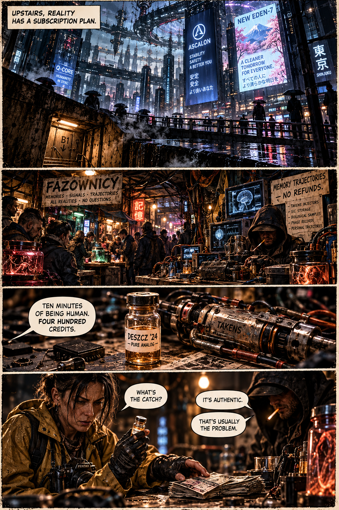
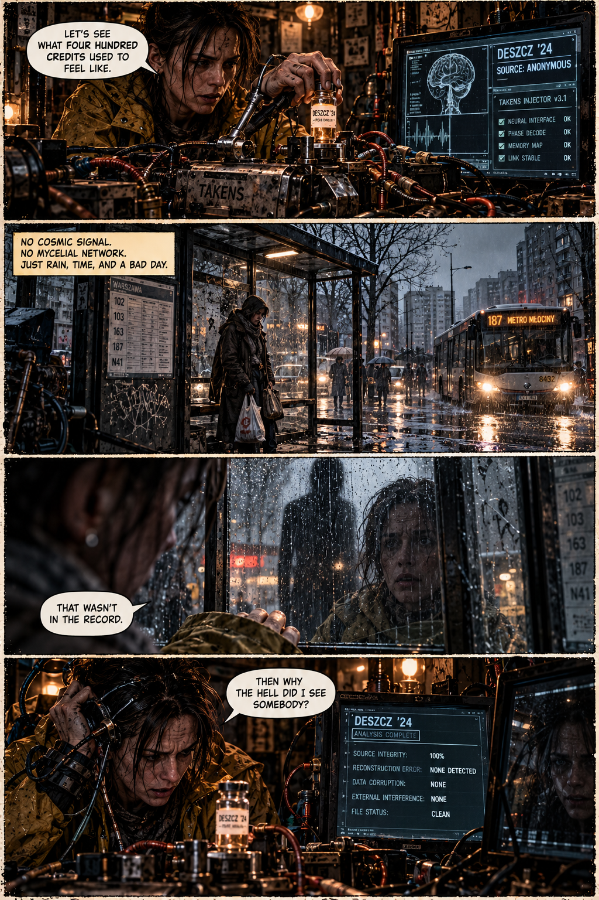
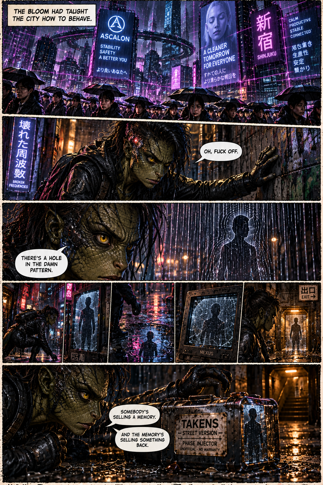
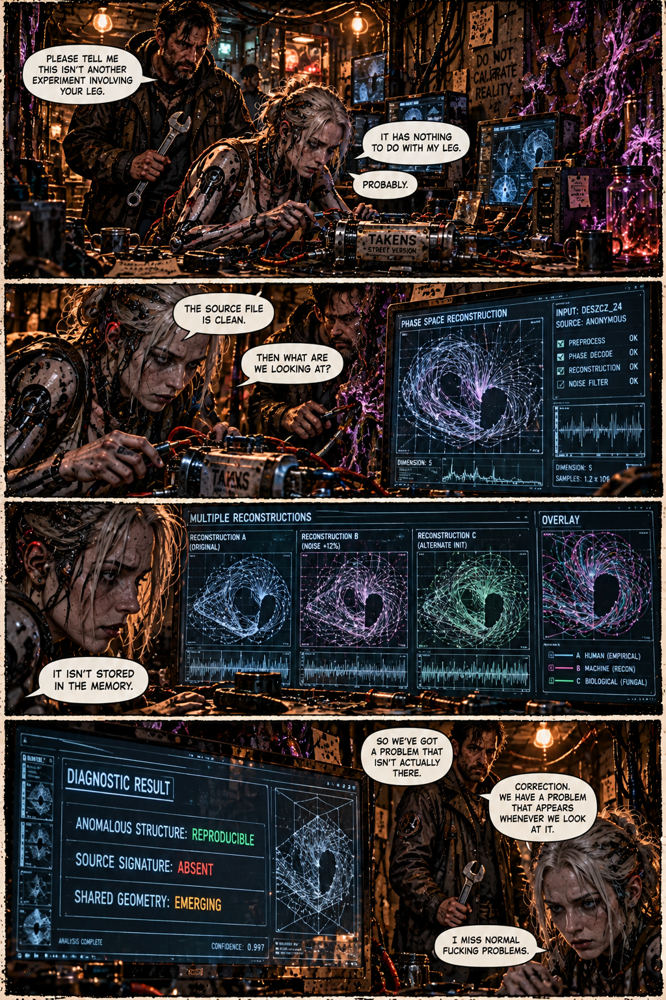
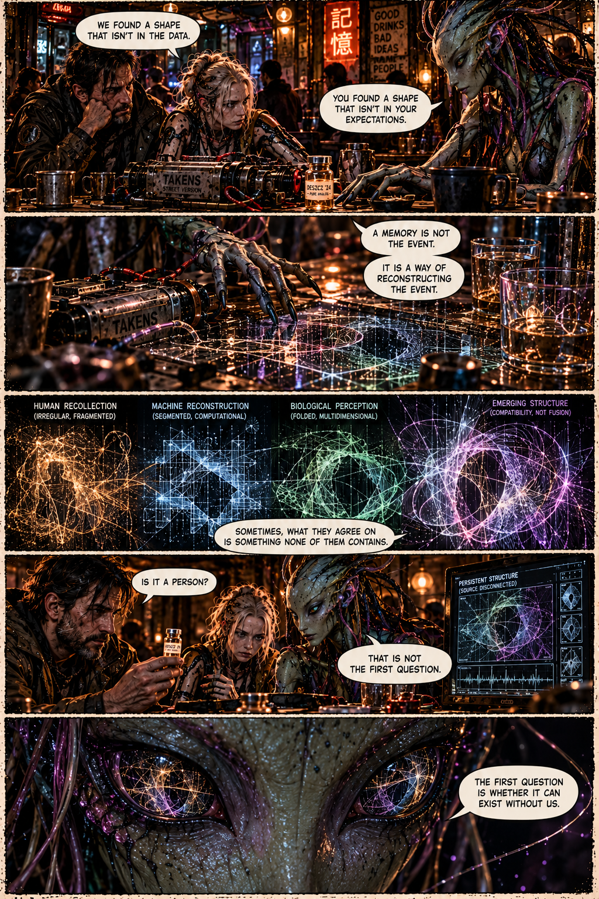
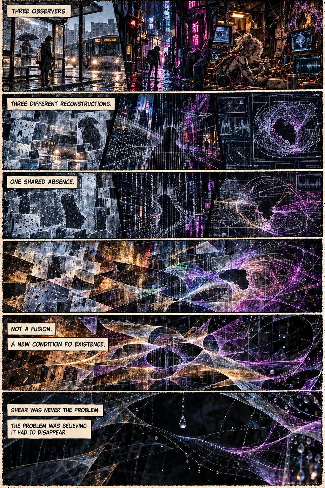
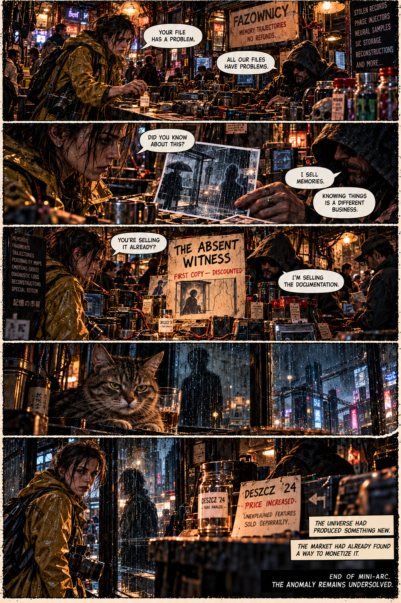

**THE MEMORY THAT NEVER HAPPENED** is a TOKIO DRIFT ’44 mini-comic about an illegal memory market, a corrupted sense of reality, and an anomaly that appears across independent observations. As Mara, Jax, Powolniak, Krzysztof, and Prism investigate a memory that seems impossibly clean, they uncover a structure that none of them can fully explain. Nobody knows what it is — but the black market has already found a way to sell it.

**The universe created something new. Someone immediately put a price tag on it.**

🛸
